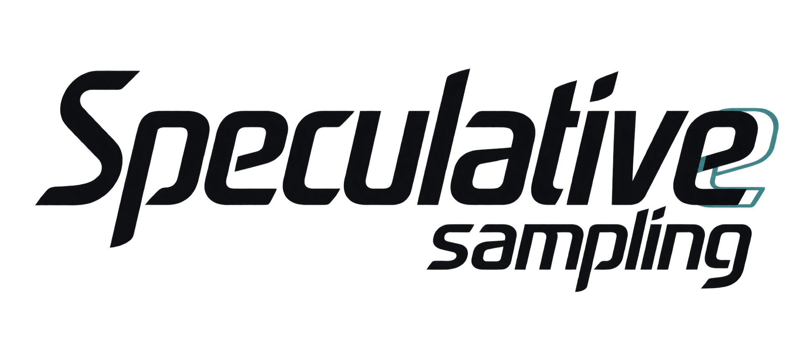
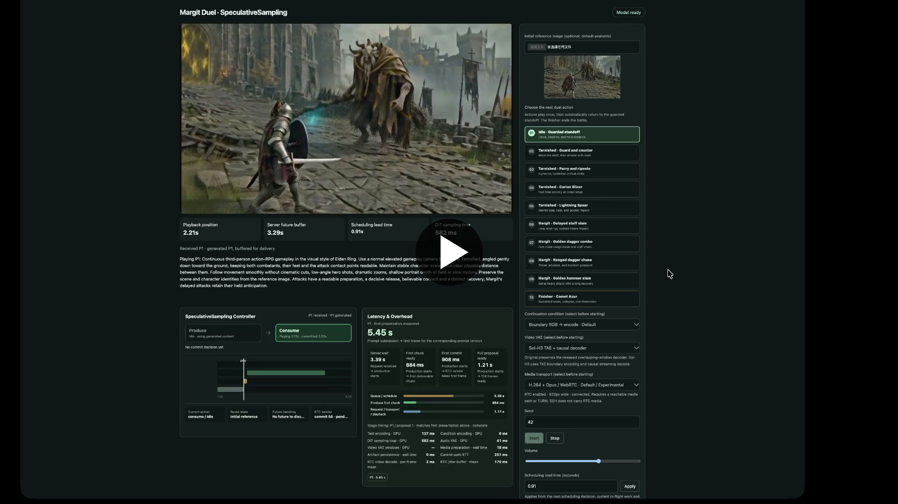
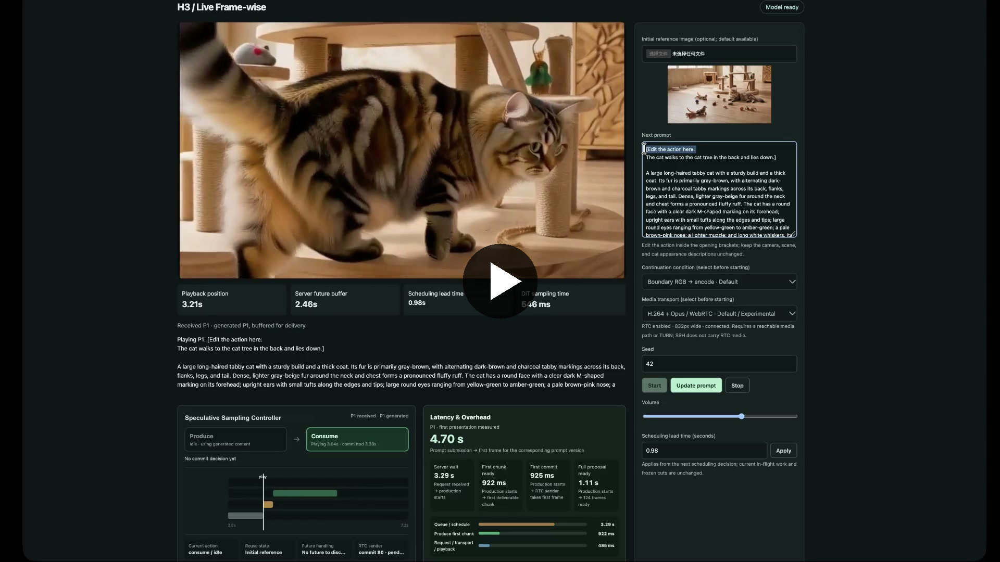
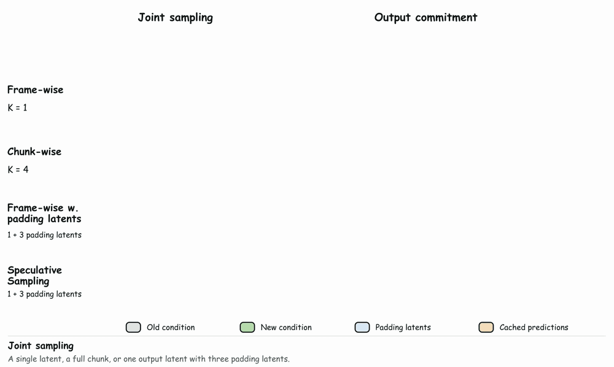
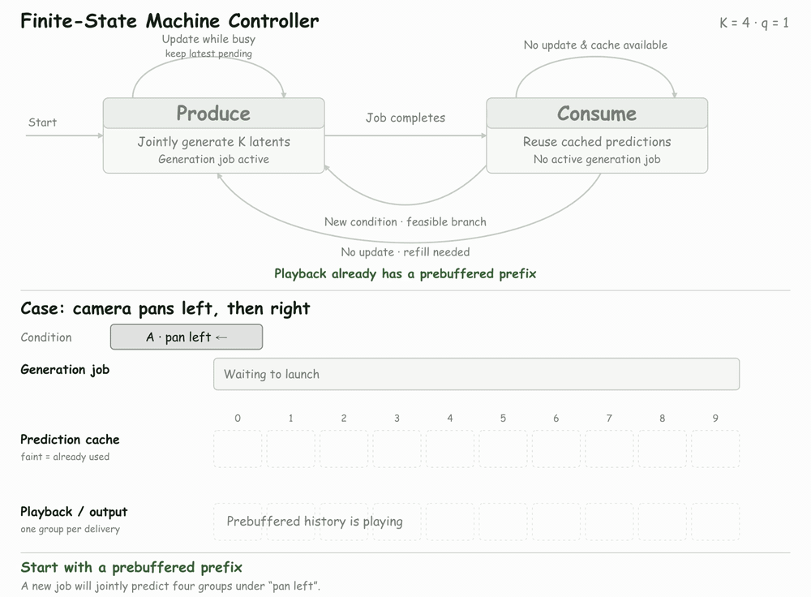

<p align="center">
  
</p>

<div align="center">

### Making Bidirectional Video Generation Models Interactive

[](https://yubo-shankui.github.io/speculative_sampling/)
[](https://arxiv.org/pdf/2610.20556)

</div>

Speculative Sampling is a serving method for autoregressive video generation.
It preserves the strong modeling capability of large bidirectional attention
windows while retaining the low-latency interaction of small bidirectional
attention windows.

**Speculative Sampling is training-free and has the potential to be
incorporated into any interactive video generation system!**

## ✨ Highlights

- **Make a five-second bidirectional model interactive.** Speculative Sampling
  removes the extra expected interaction-latency term introduced by large
  chunks, making H3's five-second bidirectional chunks interactive. Large and
  small chunks then differ mainly in sampling time.
- **Build a new interactive game in five minutes.** Define a global prompt,
  actions, idle behavior, and optional multi-stage endings, then run them on
  the shared controller with the [game guide](docs/creating_a_game.md).
- **Bring your own model, streaming or non-streaming.** Both are supported; the
  only serving requirement is that the model samples future video faster than
  playback consumes it. Follow the
  [integration guide](docs/adding_a_model.md) to connect its valid boundaries,
  output mapping, and continuation state without retraining.

## 🎬 Demo Videos

<p align="center">
  <a href="https://yubo-shankui.github.io/speculative_sampling/assets/demo_new_2_1.mp4">
    
  </a>
</p>

<p align="center">
  <a href="https://yubo-shankui.github.io/speculative_sampling/assets/demo1_5.mp4">
    
  </a>
</p>

## 🛠️ Installation

SpeculativeSampling requires Python 3.10 or later.

```bash
git clone https://github.com/Yubo-Shankui/SpeculativeSampling.git
cd SpeculativeSampling

python -m venv .venv
source .venv/bin/activate
pip install -e '.[rtc]'
```

The H3 integration builds on the
[Sol-H3 runtime](https://github.com/NVlabs/Sana/tree/sol-engine/models/minimax_h3/Sol-H3).
Model and codec weights are not included in this repository.

### Sol-H3 runtime

Fetch only the Sol-H3 runtime from the `sol-engine` branch and expose its
`h3_runtime` package:

```bash
mkdir -p third_party checkpoints
git clone --depth 1 --filter=blob:none --sparse --branch sol-engine \
  https://github.com/NVlabs/Sana.git third_party/Sana
git -C third_party/Sana sparse-checkout set models/minimax_h3/Sol-H3

export SOL_H3_ROOT="$PWD/third_party/Sana/models/minimax_h3/Sol-H3"
export PYTHONPATH="$SOL_H3_ROOT${PYTHONPATH:+:$PYTHONPATH}"
```

### H3 checkpoint

Download the four-step H3 checkpoint used by the released integration:

```bash
python -m pip install -U "huggingface_hub[cli]"
hf download FastVideo/FastVideo-FastH3-4-step-Preview-v1-Dense-DataFree \
  --local-dir checkpoints/FastVideo-FastH3-4-step-Preview-v1-Dense-DataFree

export H3_MODEL_PATH="$PWD/checkpoints/FastVideo-FastH3-4-step-Preview-v1-Dense-DataFree"
```

### Sol-H3-VAE checkpoint

The default VAE backend uses the TAE and causal decoder released with
[StreamRender-H3](https://github.com/NVlabs/Sana/tree/sol-engine/models/streamrender_h3):

```bash
hf download Efficient-Large-Model/StreamRender-H3 \
  --include 'tae/taeh3_official.pth' \
            'causal_decoder/causal_vit24_step6000.safetensors' \
  --local-dir checkpoints/StreamRender-H3

export SOL_H3_TAE_WEIGHTS="$PWD/checkpoints/StreamRender-H3/tae/taeh3_official.pth"
export SOL_H3_CAUSAL_DECODER_WEIGHTS="$PWD/checkpoints/StreamRender-H3/causal_decoder/causal_vit24_step6000.safetensors"
export SOL_H3_FA4_ROOT="$SOL_H3_ROOT/h3_runtime/third_party/sol_attn/_vendor"
```

## 🚀 Quick Start

Run the CPU regression suite:

```bash
pip install -e '.[dev]'
pytest -q
```

Prepare a private access token:

```bash
mkdir -p results/h3/sessions
umask 077
python -c 'import secrets; print(secrets.token_urlsafe(32))' > results/h3/token
```

### Option 1: free-form TI2V interaction

Start from any reference frame, type prompts directly, and change them during
playback:

```bash
python -m torch.distributed.run --standalone --nproc_per_node=8 \
  scripts/h3_live_demo.py \
  --model "$H3_MODEL_PATH" \
  --deployment-config speculative_sampling/models/h3/configs/boundary_image_5s_b300_sol_h3_vae.json \
  --token-file results/h3/token \
  --output results/h3/sessions \
  --reference /path/to/reference.png \
  --generation-width 832 --generation-height 480 --proposal-frames 124 \
  --vae-decode stream \
  --rtc-width 832 --rtc-height 480 \
  --bind 127.0.0.1 --port 8865
```

Open `http://127.0.0.1:8865/#token=YOUR_PRIVATE_TOKEN`.

### Option 2: Elden Ring — 10-action Margit boss fight

Launch the same backend with a Margit duel reference image:

```bash
python -m torch.distributed.run --standalone --nproc_per_node=8 \
  scripts/h3_live_demo.py \
  --model "$H3_MODEL_PATH" \
  --deployment-config speculative_sampling/models/h3/configs/boundary_image_5s_b300_sol_h3_vae.json \
  --token-file results/h3/token \
  --output results/h3/margit-duel \
  --reference /path/to/margit-duel-reference.png \
  --generation-width 832 --generation-height 480 --proposal-frames 124 \
  --vae-decode stream \
  --rtc-width 832 --rtc-height 480 \
  --bind 127.0.0.1 --port 8865
```

Open `http://127.0.0.1:8865/margit-duel#token=YOUR_PRIVATE_TOKEN`. The page
provides ten actions, automatic return to idle, and the multi-stage terminal
sequence.

### Option 3: build your own interactive game in five minutes

Define a global prompt, actions, idle behavior, and optional multi-stage
endings, then follow
[Create a New Interactive Game in Five Minutes](docs/creating_a_game.md) to run
it on the same controller.

The validated deployment uses 8×B300, 832×480 at 24 FPS, a 124-frame
proposal, Sol-H3-VAE streaming decode, and WebRTC delivery. Its 0.91-second
scheduling leads are measured calibration values for this deployment, not
universal defaults. For remote deployments, provide operator-managed ICE/TURN
settings with `--rtc-ice-config` and `--rtc-browser-ice-config`.

See the [Quick Start](QUICKSTART.md) and
[H3 integration guide](speculative_sampling/models/h3/README.md) for more details.

### Video VAE backends

The H3 service supports two session-selectable backends:

- `original`: the released H3 VAE with windowed streaming decode;
- `sol-h3-vae`: the StreamRender-H3 TAE encoder and causal streaming decoder.

The default profile selects `sol-h3-vae`; the browser fixes that choice when a
session is created. Select `original` for the original VAE, or use the
original-only `boundary_image_5s_b300.json` profile. WebRTC is also enabled by
default; pass `--disable-rtc` to use the WebSocket fallback.

## 🧠 How It Works

### Speculative sampling

Speculative Sampling jointly generates a large chunk under the current
condition, assuming it will remain unchanged, and commits the predictions
incrementally. Cached predictions are reused while the condition holds;
otherwise, the replaceable suffix is discarded and regenerated.

<p align="center">
  <a href="https://yubo-shankui.github.io/speculative_sampling/assets/figures/fig1-padding-continuous-v9.mp4">
    
  </a>
</p>

Padding latents expand the bidirectional modeling window. Speculative Sampling
caches their predictions for reuse instead of discarding them, while replacing
uncommitted predictions when the condition changes.

### Managing a revocable future

Prediction reuse, replacement, and refill are managed by a minimal two-state
controller:

1. **Consume:** reuse cached predictions and commit them incrementally.
2. **Produce:** refill the cache or replace an uncommitted suffix under a new
   condition.

<p align="center">
  <a href="https://yubo-shankui.github.io/speculative_sampling/assets/figures/fig3-controller-case.mp4">
    
  </a>
</p>

When a new condition arrives, playback continues from the committed prefix.
The controller preserves what can no longer be changed and regenerates the
remaining future from the earliest feasible point. If the condition does not
change, it refills the cache before available predictions run out.

This makes bidirectional attention window size a decision variable for jointly
optimizing visual quality and per-chunk sampling time, rather than a necessary
constraint on low-latency interaction.

## 📦 Repository Layout

```text
speculative_sampling/
  core/                 scheduling algorithm and typed contracts
  runtime/              WebSocket, WebRTC, media, and workers
  models/h3/            H3 boundary-image continuation adapter
  models/ltx/           LTX retained-KV/ReRoPE integration (tuning)
  models/wan/           Wan CF++ retained-KV integration (tuning)
scripts/
  h3_live_demo.py       H3 interactive service entry point
examples/games/
  my_game.js            five-minute custom game template
```

Speculative Sampling includes integrations for H3, LTX, and Wan. H3 is tuned,
documented, and recommended for use. The LTX and Wan integrations are
implemented and publicly available, but remain under active tuning; we
therefore do not currently recommend them or provide launch instructions.

## 🔌 Bring Your Own Model

Speculative Sampling separates model-native continuation from scheduling and
media delivery. A new integration supplies three things:

1. valid boundaries where an uncommitted future may be replaced;
2. a mapping from native outputs to logical playback groups;
3. continuation state, such as a decoded boundary image or retained KV cache.

The sampler may be streaming or non-streaming. No per-latent streaming
interface is required; it only needs to produce usable future video faster
than that video is consumed during playback.

The controller, prompt-version semantics, incremental commitment, and RTC
transport remain shared. Follow the
[model integration guide](docs/adding_a_model.md) for the contracts, package
layout, implementation paths, and validation checklist.

## 🙏 Acknowledgements

- [NVlabs/Sana · Sol-H3](https://github.com/NVlabs/Sana/tree/sol-engine/models/minimax_h3/Sol-H3)
  provides the optimized H3 inference runtime used by this integration.
- [StreamRender-H3](https://github.com/NVlabs/Sana/tree/sol-engine/models/streamrender_h3)
  provides the streaming TAE and causal H3 decoder used by the optional
  `sol-h3-vae` backend; its
  [checkpoint repository](https://huggingface.co/Efficient-Large-Model/StreamRender-H3)
  hosts the corresponding weights.
- [FastVideo/FastVideo-FastH3-4-step-Preview-v1-Dense-DataFree](https://huggingface.co/FastVideo/FastVideo-FastH3-4-step-Preview-v1-Dense-DataFree)
  is the four-step H3 checkpoint used by the released demo.
We thank the authors of these projects. Their original licenses and model terms
continue to apply.

## 📄 License

The code in this repository is released under the
[Apache License 2.0](LICENSE): commercial use, modification, and redistribution
are permitted when the license and copyright notices are preserved. It also
includes an explicit patent grant and provides the software without warranty.
External model weights and runtimes retain their own licenses.
